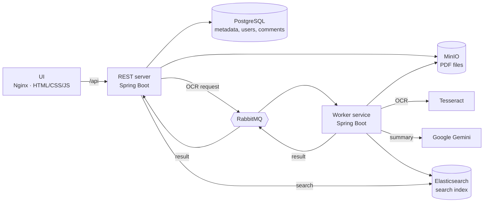
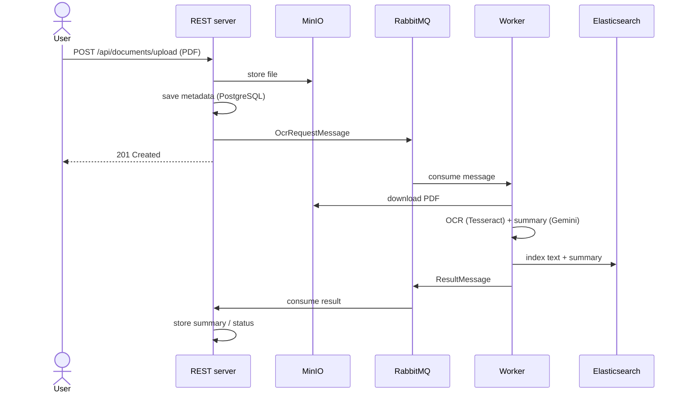

<div align="center">

# Document Management System

**Upload, OCR, AI summaries and full-text search for PDF documents – built as an event-driven microservice system**


[](https://github.com/if23b152/document_system/actions/workflows/ci.yml)

</div>

---

Users sign in, upload PDFs and get them back **searchable**: every document is stored in object storage, processed asynchronously with **Tesseract OCR**, summarised by **Google Gemini** and indexed in **Elasticsearch**. A lightweight web UI lets users browse, edit metadata, comment and read the extracted text in a focused speed-reading mode.

## Contents

- [Highlights](#highlights)
- [Architecture](#architecture)
- [Quick start](#quick-start)
- [Configuration](#configuration)
- [API](#api)
- [Security](#security)
- [Project structure](#project-structure)
- [Development](#development)
- [Roadmap](#roadmap)

## Highlights

| | |
|---|---|
| 🔐 **Accounts** | registration, login, session-based auth, per-user document access, optional admin account, demo guest login |
| 📄 **Documents** | PDF upload, in-browser viewer, edit filename / summary / tags, delete |
| ⚙️ **Async pipeline** | RabbitMQ decouples upload from processing – the API stays fast while OCR runs in the background |
| 🔎 **OCR + AI** | Tesseract extracts text, Gemini generates a short summary |
| 🧭 **Search** | full-text and fuzzy search over content and summaries via Elasticsearch |
| 💬 **Comments** | discuss documents directly on the details page |
| 📖 **Reader mode** | split view with PDF and an RSVP speed reader (adjustable WPM, progress saved per document) |

## Architecture



**Upload flow**



UML class and dependency diagrams for both services are in the repository root (`rest-server UML diagram*.png`, `worker-service UML diagram*.png`).

## Quick start

**Requirements:** Docker Desktop (≈ 4 GB RAM for Elasticsearch and the services) and a Google Gemini API key for summaries.

```bash
# 1. Configuration
cp .env.example .env            # change the passwords
cp api.env.example api.env      # insert your GOOGLE_API_KEY

# 2. Build and start the full stack
docker compose up --build
```

Open **http://localhost:8080**, register an account (or use the guest login) and upload a PDF.

| Service | URL |
|---|---|
| Web UI | http://localhost:8080 |
| REST API | http://localhost:8081/api |
| Worker | http://localhost:8082 |
| RabbitMQ management | http://localhost:15672 |
| MinIO console | http://localhost:9001 |
| Elasticsearch | http://localhost:9200 |
| PostgreSQL | `localhost:5432`, database `documentdb` |

All ports are bound to `127.0.0.1` only.

```bash
docker compose down        # stop
docker compose down -v     # stop and delete all data (DB, files, index)

# inspect the database
docker compose exec postgres psql -U postgres -d documentdb -c '\dt'
```

## Configuration

| File | Variable | Purpose |
|---|---|---|
| `.env` | `POSTGRES_USER`, `POSTGRES_PASSWORD` | database credentials |
| `.env` | `RABBITMQ_USER`, `RABBITMQ_PASSWORD` | message broker credentials |
| `.env` | `MINIO_ROOT_USER`, `MINIO_ROOT_PASSWORD` | object storage credentials (password ≥ 8 chars) |
| `.env` | `APP_ADMIN_PASSWORD` | optional – creates the `admin` account on first start |
| `.env` | `POSTGRES_HOST_PORT` | optional – host port for PostgreSQL if `5432` is already in use (default `5432`) |
| `api.env` | `GOOGLE_API_KEY` | Gemini API key used by the worker service |

Both files are git-ignored; templates: [`.env.example`](.env.example), [`api.env.example`](api.env.example).

## API

All endpoints are under `/api`. Except for `/api/auth/**`, every request requires a valid session.

**Auth**

| Method | Path | Description |
|---|---|---|
| `POST` | `/api/auth/register` | create an account |
| `POST` | `/api/auth/login` | log in (starts a session) |
| `POST` | `/api/auth/try` | log in with a temporary guest account |
| `POST` | `/api/auth/logout` | end the session |
| `GET` | `/api/auth/me` | current user |

**Documents**

| Method | Path | Description |
|---|---|---|
| `POST` | `/api/documents/upload` | upload a PDF (multipart) |
| `GET` | `/api/documents` | list own documents |
| `GET` | `/api/documents/{id}` | document metadata |
| `PUT` | `/api/documents/{id}` | update filename, summary, tags |
| `DELETE` | `/api/documents/{id}` | delete document |
| `GET` | `/api/documents/{id}/file` | stream the original PDF |
| `GET` | `/api/documents/{id}/text` | extracted OCR text |
| `GET` | `/api/documents/search?query=…` | full-text search |

**Comments**

| Method | Path | Description |
|---|---|---|
| `POST` | `/api/comments/document/{documentId}` | add a comment |
| `GET` | `/api/comments/document/{documentId}` | list comments |
| `DELETE` | `/api/comments/{commentId}` | delete a comment |

## Security

- Passwords hashed with **BCrypt**; login attempts are rate-limited per account
- Session cookie `HttpOnly`, `SameSite=Strict`, 60 min timeout, session ID rotated on login
- Users only see and modify **their own** documents and comments; `admin` role for moderation
- Upload size limits and comment length validation
- No secrets in the repository – all credentials come from `.env` / `api.env`
- Every container port is bound to `localhost`

> Elasticsearch runs without X-Pack security in this single-node development setup and should not be exposed beyond localhost.

## Project structure

```text
document_system/
├── rest-server/            REST API (Spring Boot)
│   └── src/main/java/.../
│       ├── config/         Security, MinIO, RabbitMQ, Elasticsearch
│       ├── controller/     Auth, Document, Comment, Search
│       ├── service/        business logic, login attempts, storage, search
│       ├── listener/       consumes worker results
│       ├── producer/       publishes OCR requests
│       ├── model/          entities and DTOs
│       ├── mapper/         MapStruct mappers
│       └── repository/     Spring Data JPA
├── worker-service/         OCR, Gemini summary, Elasticsearch indexing
├── ui/                     static frontend (HTML/CSS/JS) served by Nginx
├── docker-compose.yml      full local stack
├── .env.example            infrastructure credentials template
└── api.env.example         Gemini API key template
```

## Development

```bash
# run the tests (no running infrastructure needed – external services are mocked)
(cd rest-server && ./mvnw test)       # 29 tests
(cd worker-service && ./mvnw test)    # 9 tests

# rebuild a single service after code changes
docker compose up --build rest-server
```

The root [`pom.xml`](pom.xml) aggregates the REST server; the worker service is a standalone Maven project with its own wrapper (`worker-service/mvnw`). In IntelliJ, import `worker-service/pom.xml` as an additional Maven module.

## Roadmap

- processing status indicator per document in the UI
- highlighted search matches and faceted filters
- document versioning
- end-to-end tests against the full Docker stack
