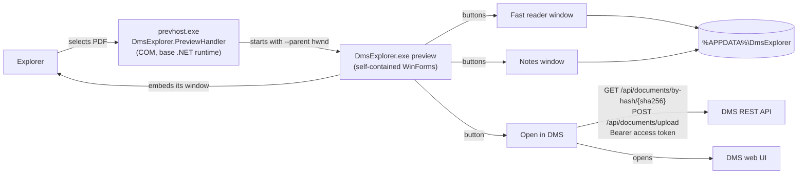

# DmsExplorer – Windows Explorer integration

Brings the document system into Windows Explorer: select a PDF and the **preview pane** shows the document together with actions – **fast reader**, **notes** and **open in DMS**. The same actions are available in the **context menu**.

> Prototype. Notes are stored locally for now; syncing them with DMS comments is the next step.

## Features

| | |
|---|---|
| 🖼️ **Preview pane** | PDF pages rendered with the PDF engine built into Windows, action bar on top, first line of your note shown as a yellow strip |
| ⚡ **Fast reader** | RSVP speed reading directly on the local PDF: highlighted focus letter, 100–1000 wpm, pauses at punctuation, position remembered per document |
| 📝 **Notes** | one note per document with autosave; it follows the file when it is renamed or moved (keyed by the SHA-256 of the content) |
| ↗ **Open in DMS** | finds the file in the DMS by its content hash and opens its page; if it is not there yet, offers to upload it |
| 🖱️ **Context menu** | *Document System → Fast reader / Notes / Open preview window / Open in DMS* |

Keys in the fast reader: `Space` start/pause · `←` `→` step · `↑` `↓` speed · `Home` restart · `Esc` close.

## How it works



- **Preview handler** – a tiny COM component (`IPreviewHandler`) without UI dependencies. Explorer loads it into `prevhost.exe` using the machine-wide .NET runtime; it starts the companion app and passes the preview pane window.
- **Companion app** – self-contained, so it does not depend on which .NET runtimes are installed. It turns its window into a child of the preview pane and follows its size; it exits when the pane goes away.
- **Core** – notes, reader progress, settings, PDF text extraction ([PdfPig](https://github.com/UglyToad/PdfPig)) and RSVP timing, covered by unit tests.

## Install

Requirements: Windows 10/11 x64, [.NET 8 SDK](https://dotnet.microsoft.com/download) to build, and a machine-wide .NET 8+ runtime (`C:\Program Files\dotnet`) for the preview handler.

```powershell
cd desktop
.\install.ps1
```

The script builds everything as your user, then asks **once for administrator rights** to copy the files to `C:\Program Files\DmsExplorer` and register the preview handler and context menu machine-wide. Every registry step is written to `%TEMP%\DmsExplorer-install.log`.

> **Why administrator rights?** Current Windows versions refuse per-user COM registrations from unknown programs and protect the `.pdf` association (User Choice Protection Driver). A machine-wide registration is the supported way for preview handlers.

Then open Explorer, turn on the preview pane (`Alt+P`) and select a PDF. The context menu entry is under *Show more options* on Windows 11.

The install replaces the PDF preview (usually Edge's) for this PC. Uninstall restores it:

```powershell
.\install.ps1 -Uninstall
```

Notes and settings stay in `%APPDATA%\DmsExplorer` (`settings.json` holds the DMS URL, default `http://localhost:8080`).

## Connect to the DMS

*Open in DMS* needs a personal access token of your DMS account:

1. Log in to the DMS web UI and create a token (`POST /api/tokens` with `{ "name": "Laptop" }`; a page in the web UI will follow).
2. Run `DmsExplorer connect` (or just click *Open in DMS* – the dialog appears when no token is saved), enter the DMS address and paste the token.

The connection is tested before anything is saved. The token is stored encrypted for your Windows account (DPAPI, `%APPDATA%\DmsExplorer\token.bin`); *Remove token* in the same dialog deletes it. Revoke it in the DMS when a device is lost.

## Development

```powershell
dotnet test desktop/DmsExplorer.sln            # core unit tests
dotnet run --project desktop/src/DmsExplorer.App -- preview C:\path\file.pdf
dotnet run --project desktop/src/DmsExplorer.App -- reader  C:\path\file.pdf
dotnet run --project desktop/src/DmsExplorer.App -- notes   C:\path\file.pdf
dotnet run --project desktop/src/DmsExplorer.App -- open    C:\path\file.pdf
dotnet run --project desktop/src/DmsExplorer.App -- connect
```

Without `--parent` the preview opens as a normal window, which is the easiest way to work on the UI.

```text
desktop/
├── src/
│   ├── DmsExplorer.Core/            notes, settings, reader progress, PDF text, RSVP timing, DMS API client
│   ├── DmsExplorer.App/             companion app: preview, fast reader, notes, connect, open in DMS (WinForms)
│   └── DmsExplorer.PreviewHandler/  COM preview handler loaded by Explorer
├── tests/DmsExplorer.Core.Tests/    xUnit tests with generated PDFs
└── install.ps1                      build, install, register / uninstall
```

## Roadmap

1. ✅ Preview pane, fast reader, local notes, context menu
2. ✅ Find a document by content hash · ✅ access tokens · ✅ open in DMS / upload from Explorer · web UI page for tokens · sync notes with DMS comments
3. Fast reader and notes on the OCR text of scanned PDFs (from the DMS worker)
4. Signed MSIX package and settings window
